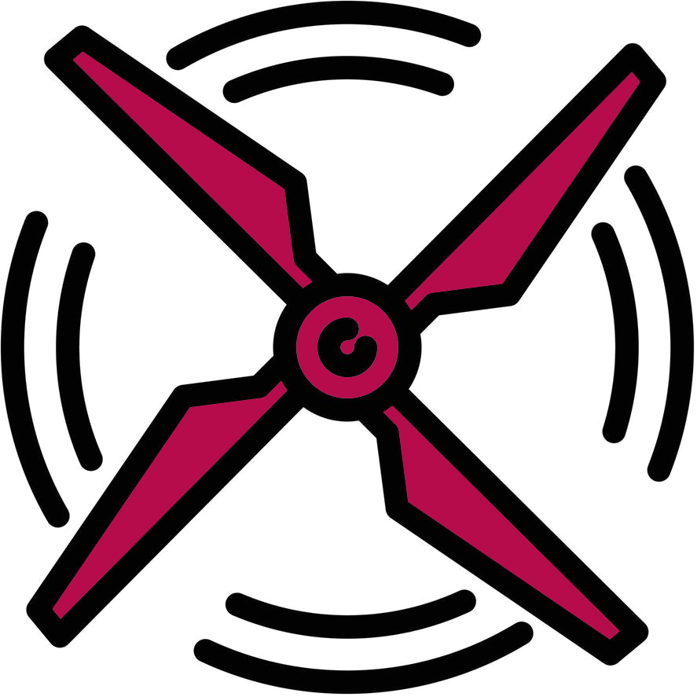
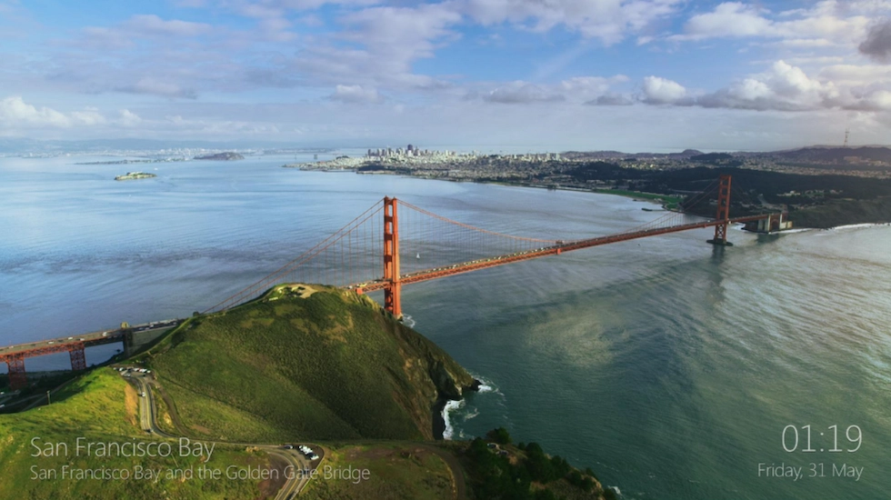
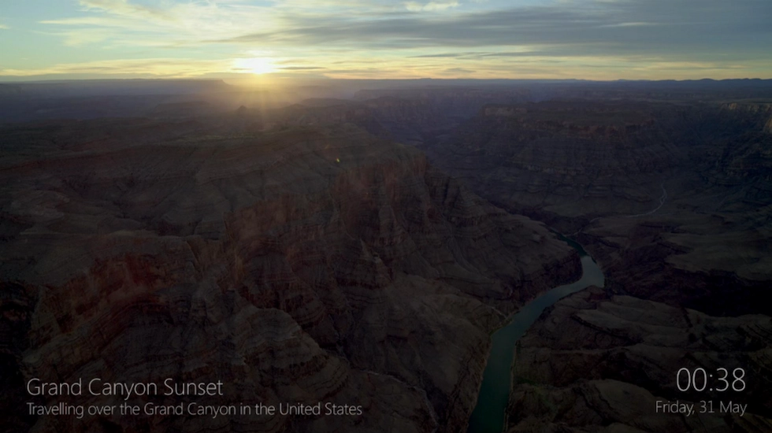
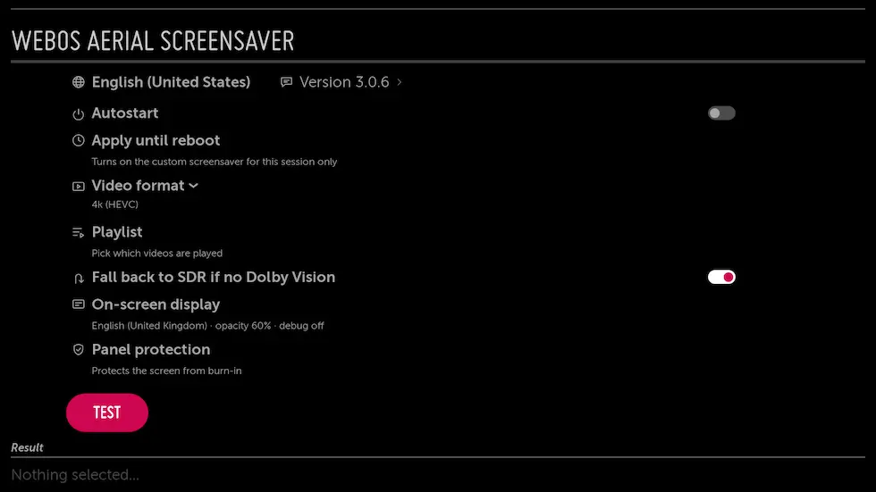
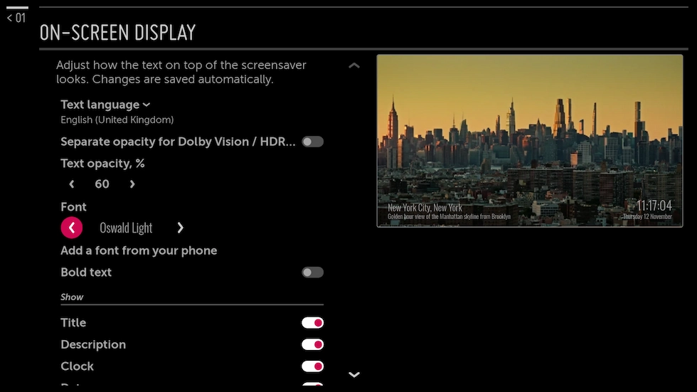
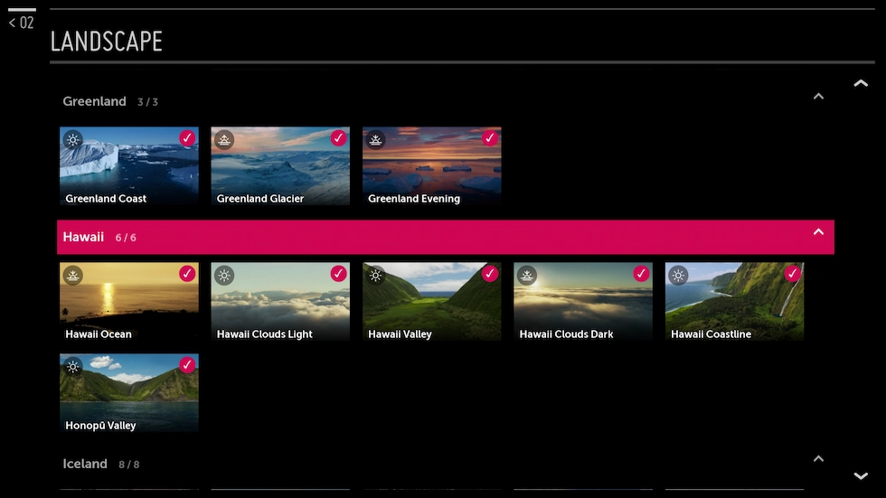
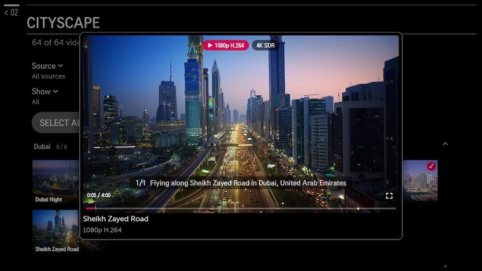

 <h1>Aerial webOS screensaver (fork of <a href="https://github.com/webosbrew/custom-screensaver">custom-screensaver</a>)</h1>

Aerial-style video screensaver for LG webOS TVs.

## Screenshots

<table>
  <tr>
    <td></td>
    <td></td>
    <td></td>
  </tr>
  <tr>
    <td></td>
    <td></td>
    <td></td>
  </tr>
</table>

## Features

* [330+ videos](https://aabytt.github.io/aerial-preview/) from different sources (Apple Aerials, Amazon FireOS, Jetson Creative, Robin Fourcade)
* 40+ locales for OSD
* Source type selection (FullHD/4k SDR or Dolby Vision)
* Playlist editor
* Night mode: a separate playlist for the night hours
* Autostart registration
* Temporary apply
* Launch screensaver immediately for testing

## Requirements

* A rooted LG TV with the [Homebrew Channel](https://www.webosbrew.org/) installed
* webOS 5 (2020), webOS 6 (2021), webOS 22 (7.x), webOS 23 (8.x), webOS 25 (10.x) or webOS 26 (11.x)

> [!WARNING]
> The app replaces the original webOS screensaver. Use at your own risk.

## Installation

The app should be available in the Homebrew Channel. Otherwise, download the `.ipk` from
[Releases](https://github.com/aabytt/custom-screensaver-aerial/releases/latest) and install it on your TV
with your preferred tool (e.g. webOS Dev Manager or `ares-install`).

## Compatibility

See the [compatibility table](COMPATIBILITY.md) for tested TVs, or
[submit your own report](https://github.com/aabytt/custom-screensaver-aerial/issues/new?template=compatibility.yml).
Tap the `Version` field in the app to read your TV details.

webOS 25 and 26 use a different implementation of the screensaver. See
[webOS 25 and 26 notes](docs/webos-25-26.md) for how it works and for upgrade instructions.

## Donate

Looking for more sources or cool new features? Your support would mean the world!
Donations are entirely optional and don't affect support or access to any features.

**USDT (Tether), network: TRC-20 (Tron)**

`THKrpAfuQ8rbrjjMuvuLii7dcbUD6dVW93`

Show QR code

> ⚠️ Send USDT on the **TRC-20** network only. Transfers on other networks (ERC-20, BEP-20, etc.) will be lost.

Other options:
* [YooMoney](https://yoomoney.ru/to/4100115685800097)
